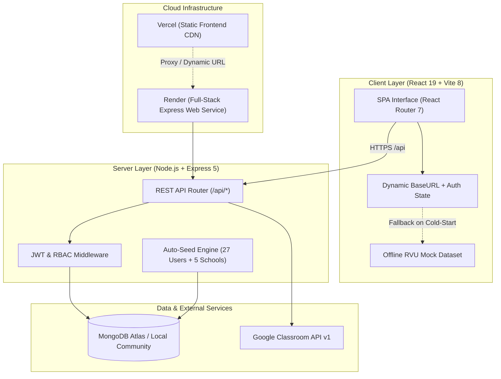

# RV University — Campus Connect Portal

[](https://nodejs.org/)
[](https://expressjs.com/)
[](https://react.dev/)
[](https://vitejs.dev/)
[](https://www.mongodb.com/)
[](https://render.com/)
[](https://vercel.com/)
[](https://opensource.org/licenses/ISC)

> **Campus Connect Portal** is an enterprise-grade, full-stack academic management and learning portal engineered specifically for **RV University, Bengaluru**. It unites course workflows, digital assignment submissions and grading, live attendance tracking with eligibility rules, official university broadcasts, central institutional audit governance, and Google Classroom synchronization into a single seamless experience.

---

## Table of Contents

- [Key Highlights & Architecture](#-key-highlights--architecture)
- [System Architecture](#-system-architecture)
- [Role-Based Access Control (RBAC)](#-role-based-access-control-rbac)
  - [1. Student Portal](#1-student-portal)
  - [2. Faculty Portal (Mini Google Classroom)](#2-faculty-portal-mini-google-classroom)
  - [3. Central Administration & Governance Console](#3-central-administration--governance-console)
- [Preloaded RV University Demo Credentials](#-preloaded-rv-university-demo-credentials)
- [Tech Stack](#-tech-stack)
- [Project Directory Structure](#-project-directory-structure)
- [Environment Variables](#-environment-variables)
- [Local Installation & Setup](#-local-installation--setup)
- [Automated Smoke Test Suite](#-automated-smoke-test-suite)
- [API Endpoints Reference](#-api-endpoints-reference)
- [Production Deployment Guide](#-production-deployment-guide)
  - [Option A: Render (Full-Stack Web Service)](#option-a-render-full-stack-web-service)
  - [Option B: Vercel (Frontend) + Render (Backend)](#option-b-vercel-frontend--render-backend)
- [Resilience & Fail-Safe Architecture](#-resilience--fail-safe-architecture)
- [License](#-license)

---

## 🌟 Key Highlights & Architecture

- **Strict Multi-Role Isolation**: Dedicated, role-enforced dashboards for Students, Faculty, and Administrators with zero route leakage.
- **Bi-Directional Classroom Sync**: Live Google OAuth 2.0 integration with the official Google Classroom API v1 + instant realistic simulation fallback when running without cloud credentials.
- **Fail-Fast Cloud Startup**: Immediate HTTP port-binding prevents Render free-tier deployment timeouts while MongoDB connects and auto-seeds asynchronously in the background.
- **Dynamic Backend Connector**: Embedded frontend health probe and dynamic URL linker allows a Vercel frontend to effortlessly communicate with any Render backend instance.
- **Instant Standalone Demo Mode**: Built-in high-fidelity offline RV University dataset (27 preloaded users across 5 schools, courses, assignments, notices, attendance registers) ensures the app functions with zero network dependencies.
- **Automated Verification**: End-to-end 16-step smoke test suite covering authentication, RBAC, grading, and broadcast flows.

---

## 📐 System Architecture



---

## 👥 Role-Based Access Control (RBAC)

The portal provides three distinct views tailored to institutional responsibilities:

### 1. Student Portal
- **Dashboard Overview**: Active semester summary, credit load, and enrolled courses across departments (SoCSE, SoB, SoDI, SoE, SoLAS).
- **Coursework & Submissions**: View assignment briefs, submission deadlines, attach repository links and commentary, and view real-time grading feedback from faculty.
- **Digital Attendance Tracker**: Aggregate attendance percentage with status indicators (`Eligible`, `Review Warning`, `Ineligible`) based on RV University's 75% attendance threshold.
- **Campus Notice Feed**: Official circulars with priority tags (`Urgent`, `Academic Circular`, `General Notice`).
- **Profile Customization**: Personal details, USN, academic branch, and local profile photo upload with persistent storage.
- **Google Classroom Integration**: 1-click connect to Google Classroom account with sync controls.

### 2. Faculty Portal (Mini Google Classroom)
- **Course Offerings**: Real-time listing of assigned subject modules, credits, and cohort sections.
- **Assignment Management**: Author and publish new coursework with maximum marks and submission deadlines; delete inactive coursework.
- **Review & Grading Desk**: Inspect student submissions, enter numerical scores, and attach personalized academic feedback.
- **Digital Attendance Register**: Select course and date to mark student attendance registers (`Present` / `Absent`) with batch save.
- **Cohort Announcements**: Post direct circulars and updates visible on student feeds.

### 3. Central Administration & Governance Console
- **Institutional Metrics**: Live KPI metrics displaying enrolled student count, faculty instructors, active coursework assignments, and submission aggregates.
- **User Directory**: Searchable directory filtering students, faculty, and administrators with USN/Employee ID lookups and account status controls.
- **Campus Broadcast Desk**: Broadcast official notices instantly dispatched to all student and faculty dashboards.
- **System Health & Audit**: Real-time server telemetry, database connection status, active session counts, and audit logs.

---

## 🔑 Preloaded RV University Demo Credentials

The login screen features 1-click autofill buttons and a dropdown for instant access without manual typing:

| Role | Name | Email Address | Password | Department / USN |
| :--- | :--- | :--- | :--- | :--- |
| **Administrator** | Campus IT Administrator | `admin@rvu.edu.in` | `admin123` | Central IT & Academic Governance |
| **Administrator** | Dr. K. S. Sridhar (Dean) | `dean.academics@rvu.edu.in` | `admin123` | Office of the Academic Dean |
| **Administrator** | Dr. D. P. Nagaraj (Registrar) | `registrar@rvu.edu.in` | `admin123` | Office of the Registrar |
| **Faculty** | Dr. Ramesh Kumar | `faculty@rvu.edu.in` | `faculty123` | SoCSE — Full Stack Web Dev |
| **Faculty** | Prof. Ananya Sharma | `ananya.sharma@rvu.edu.in` | `faculty123` | SoCSE — Database Systems |
| **Faculty** | Dr. Arvind Rao | `arvind.rao@rvu.edu.in` | `faculty123` | SoCSE — Networks & Security |
| **Faculty** | Dr. Priya Sundaram | `priya.sundaram@rvu.edu.in` | `faculty123` | SoCSE — Applied Machine Learning |
| **Student** | Test Student | `student@rvu.edu.in` | `password123` | 1RV21CS001 (SoCSE, Year 3) |
| **Student** | Nishit Patel | `patelnishitkumarbsc24@rvu.edu.in` | `password123` | 1RUA24SCS0068 (SoCSE, Year 2) |
| **Student** | Aarav Sharma | `aarav.sharma@rvu.edu.in` | `password123` | 1RV22CS014 (SoCSE, Year 3) |
| **Student** | Diya Reddy | `diya.reddy@rvu.edu.in` | `password123` | 1RV22CS032 (SoCSE, Year 3) |
| **Student** | Meera Iyer | `meera.iyer@rvu.edu.in` | `password123` | 1RV23BBA045 (School of Business) |

> **Pro Tip**: If running without any backend or database, click **"Continue in Standalone Demo Mode (Instant Access)"** on the login page to immediately enter the dashboard.

---

## 🛠️ Tech Stack

### Frontend (`client--/`)
- **Library**: [React 19](https://react.dev/)
- **Bundler & Dev Server**: [Vite 8](https://vitejs.dev/)
- **Routing**: [React Router 7](https://reactrouter.com/)
- **HTTP Client**: [Axios](https://axios-http.com/) (configured with 60s timeout, auto-JWT interceptors, dynamic base URL resolver)
- **Icons**: Custom clean inline SVG icon components ([`Icons.jsx`](client--/src/components/Icons.jsx))
- **Design System**: Responsive glassmorphic layout, university brand palette (`#166534`, `#991b1b`, `#1e40af`), zero external component library bloat.

### Backend (`server/`)
- **Runtime**: [Node.js](https://nodejs.org/) (ES Modules & CommonJS compatibility)
- **Framework**: [Express 5](https://expressjs.com/)
- **Database & ODM**: [MongoDB](https://www.mongodb.com/) via [Mongoose 9](https://mongoosejs.com/)
- **Authentication**: JWT ([`jsonwebtoken`](https://github.com/auth0/node-jsonwebtoken)) + [`bcryptjs`](https://github.com/dcodeIO/bcrypt.js) password hashing
- **External Integration**: Google Classroom API ([`googleapis`](https://github.com/googleapis/google-api-nodejs-client))
- **Security & Middleware**: `cors`, `express.json()`, role-based authorization guards

---

## 📁 Project Directory Structure

```
campus-connect-portal/
├── client--/                      # React 19 + Vite Frontend SPA
│   ├── public/                    # Static favicon and brand assets
│   ├── src/
│   │   ├── components/            # Reusable UI modules
│   │   │   ├── AdminPortal.jsx    # Institutional administration console
│   │   │   ├── AuthModule.jsx     # Login/Register with dynamic connector
│   │   │   ├── FacultyPortal.jsx  # Instructor assignment & grading suite
│   │   │   └── Icons.jsx          # Pure SVG Lucide-style icon suite
│   │   ├── pages/
│   │   │   ├── Dashboard.jsx      # Student portal & role dispatcher
│   │   │   └── LandingPage.jsx    # University public landing page
│   │   ├── api.js                 # Unified Axios client with fallback
│   │   ├── mockData.js            # Comprehensive offline RVU dataset
│   │   ├── style.css              # Global university stylesheet
│   │   ├── App.jsx                # Application routes
│   │   └── main.jsx               # React entry point
│   ├── package.json
│   ├── vercel.json                # Vercel SPA routing configuration
│   └── vite.config.js
│
├── server/                        # Express 5 Backend
│   ├── src/
│   │   ├── config/
│   │   │   ├── db.js              # Resilient MongoDB connection with fail-fast timeouts
│   │   │   └── seed.js            # Auto-seed script (27 users, courses, notices, attendance)
│   │   ├── controllers/
│   │   │   ├── adminController.js
│   │   │   ├── authController.js  # JWT auth with demo failover
│   │   │   ├── classroomController.js # Google Classroom OAuth & simulator
│   │   │   └── facultyController.js
│   │   ├── middleware/
│   │   │   └── auth.js            # JWT verification & RBAC check
│   │   ├── models/                # Mongoose Document Schemas
│   │   │   ├── Assignment.js
│   │   │   ├── Attendance.js
│   │   │   ├── Course.js
│   │   │   ├── Notice.js
│   │   │   ├── Submission.js
│   │   │   └── User.js
│   │   ├── routes/                # Express API Route handlers
│   │   └── app.js                 # Server entry point with SPA static serving
│   ├── test/
│   │   └── smoke.test.js          # Comprehensive 16-step automated smoke test
│   ├── .env.example
│   └── package.json
│
├── package.json                   # Root unified pipeline scripts
├── render.yaml                    # Infrastructure-as-code Render Blueprint
├── vercel.json                    # Root Vercel deployment configuration
└── README.md
```

---

## ⚙️ Environment Variables

Create a `.env` file inside `server/` (or copy from `server/.env.example`):

```bash
cp server/.env.example server/.env
```

| Variable | Required | Default Value | Description |
| :--- | :---: | :--- | :--- |
| `PORT` | Optional | `5000` | Port for the Express HTTP server |
| `NODE_ENV` | Optional | `development` | Environment mode (`development` or `production`) |
| `MONGO_URI` | **Required** | `mongodb://127.0.0.1:27017/campus_connect` | MongoDB connection URI (local or MongoDB Atlas) |
| `JWT_SECRET` | **Required** | `rv_university_campus_connect_secret_jwt_key_2026` | Secret key used to sign and verify JWT tokens |
| `DEMO_MODE` | Optional | `true` | When `true`, enables realistic classroom simulation without requiring Google OAuth keys |
| `GOOGLE_CLIENT_ID` | Optional | — | Google Cloud OAuth 2.0 Client ID for Classroom API |
| `GOOGLE_CLIENT_SECRET` | Optional | — | Google Cloud OAuth 2.0 Client Secret |
| `GOOGLE_REDIRECT_URI` | Optional | `http://localhost:5000/api/classroom/callback` | Authorized OAuth 2.0 redirect URI |

For the frontend (`client--/.env` or Vercel environment variables):

| Variable | Required | Description |
| :--- | :---: | :--- |
| `VITE_API_URL` | Optional | Backend base URL (e.g. `https://campus-connect-xxxx.onrender.com/api`). In production without this set, it defaults to relative `/api`. |

---

## 🚀 Local Installation & Setup

### Prerequisites
- [Node.js](https://nodejs.org/) version **18.x** or higher (Node 20+ recommended)
- [MongoDB Community Server](https://www.mongodb.com/try/download/community) running locally on port 27017, OR a free [MongoDB Atlas](https://www.mongodb.com/atlas) cluster URI.

### 1. Clone Repository
```bash
git clone https://github.com/nish-debug15/campus-connect-portal.git
cd campus-connect-portal
```

### 2. Install All Dependencies
A single unified command installs dependencies for both `server` and `client--`:
```bash
npm run install:all
```

### 3. Configure Server Environment
```bash
cp server/.env.example server/.env
```
*(If using MongoDB Atlas, update `MONGO_URI` with your connection string. Ensure IP address `0.0.0.0/0` is allowed in Atlas Network Access).*

### 4. Run Development Servers
Start both the Express backend and Vite frontend concurrently with hot-reloading:
```bash
npm run dev
```

- **Frontend Client**: `http://localhost:5173`
- **Backend API**: `http://localhost:5000`
- **Health Check**: `http://localhost:5000/api/health`

Alternatively, run them in separate terminals:
```bash
# Terminal 1: Backend Server
npm run server

# Terminal 2: Vite Client
npm run client
```

---

## 🧪 Automated Smoke Test Suite

The repository includes a comprehensive 16-step integration test that validates the entire backend pipeline, MongoDB connection, seeding, and security guards:

```bash
npm test
```

### Verified Test Cases:
```
[1]  Testing Health Check (/api/health) -> 200 OK
[2]  Student Authentication -> 200 OK
[3]  Faculty Authentication -> 200 OK
[4]  Administrator Authentication -> 200 OK
[5]  Role-Based Access Control (RBAC 403 Forbidden validation)
[6]  Faculty Coursework Creation -> 201 Created
[7]  Student Classroom Sync -> 200 OK
[8]  Student Coursework Submission -> 201 Created
[9]  Faculty Submissions Review -> 200 OK
[10] Faculty Grade Assignment Submission -> 200 OK
[11] Student Grade Verification -> 200 OK
[12] Faculty Attendance Register Recording -> 201 Created
[13] Student Attendance Percentage Calculation -> 200 OK
[14] Admin Institutional Circular Broadcast -> 201 Created
[15] Student Notice Feed Verification -> 200 OK
[16] Production SPA Static Serving -> 200 OK

ALL 16 AUTOMATED TESTS PASSED SUCCESSFULLY! ZERO BUGS DETECTED.
```

---

## 📡 API Endpoints Reference

### Public / Health
| Method | Endpoint | Description |
| :--- | :--- | :--- |
| `GET` | `/api/health` | Live service health probe, uptime, and timestamp |

### Authentication (`/api/auth`)
| Method | Endpoint | Auth | Description |
| :--- | :--- | :---: | :--- |
| `POST` | `/api/auth/register` | Public | Register new student or faculty account |
| `POST` | `/api/auth/login` | Public | Authenticate user & return signed JWT token |

### Google Classroom & Student Portal (`/api/classroom`)
| Method | Endpoint | Auth | Description |
| :--- | :--- | :---: | :--- |
| `GET` | `/api/classroom/connect-url` | Student | Generates Google OAuth 2.0 authorization URL |
| `GET` | `/api/classroom/status` | Student | Checks connection status |
| `POST` | `/api/classroom/sync` | Student | Synchronizes coursework, notices, and enrolled courses |
| `POST` | `/api/classroom/assignments/:id/submit` | Student | Submits coursework with text commentary and repo links |
| `GET` | `/api/classroom/assignments/:id/submission` | Student | Fetches current submission and grade feedback |
| `GET` | `/api/classroom/attendance` | Student | Calculates student-specific attendance percentages |

### Faculty Classroom Console (`/api/faculty`)
| Method | Endpoint | Auth | Description |
| :--- | :--- | :---: | :--- |
| `GET` | `/api/faculty/courses` | Faculty | Lists assigned course modules |
| `GET` | `/api/faculty/assignments` | Faculty | Lists created assignments |
| `POST` | `/api/faculty/assignments` | Faculty | Creates a new coursework assignment |
| `DELETE`| `/api/faculty/assignments/:id` | Faculty | Deletes coursework assignment |
| `GET` | `/api/faculty/assignments/:id/submissions` | Faculty | Lists student submissions for an assignment |
| `POST` | `/api/faculty/submissions/:id/grade` | Faculty | Grades a student submission with score & feedback |
| `POST` | `/api/faculty/announcements` | Faculty | Posts announcement to student cohort |
| `GET` | `/api/faculty/students` | Faculty | Lists enrolled students |
| `POST` | `/api/faculty/attendance` | Faculty | Records attendance session register |

### Institutional Administration (`/api/admin`)
| Method | Endpoint | Auth | Description |
| :--- | :--- | :---: | :--- |
| `GET` | `/api/admin/metrics` | Admin | Fetches executive KPI metrics |
| `GET` | `/api/admin/users` | Admin | Directory listing of all campus accounts |
| `DELETE`| `/api/admin/users/:id` | Admin | Deactivates a user account |
| `POST` | `/api/admin/broadcast` | Admin | Dispatches campus-wide official circular |
| `GET` | `/api/admin/system` | Admin | System audit telemetry & health diagnostics |

---

## 🌐 Production Deployment Guide

### Option A: Render (Full-Stack Web Service)
Render hosts both the Express API and compiled React SPA on the exact same domain, eliminating CORS and proxy complexity.

1. Create a new **Web Service** on [Render](https://dashboard.render.com).
2. Connect your GitHub repository: `campus-connect-portal`.
3. Configure the build parameters:
   - **Environment**: `Node`
   - **Build Command**: `npm run build`
   - **Start Command**: `npm start`
4. Add Environment Variables:
   - `NODE_ENV`: `production`
   - `PORT`: `5000`
   - `JWT_SECRET`: *(Click 'Generate' or enter secure 32-character string)*
   - `DEMO_MODE`: `true`
   - `MONGO_URI`: *(Your MongoDB Atlas connection string)*
5. Click **Create Web Service**. Your portal is live with both frontend and backend served together!

*(Alternatively, use the included [`render.yaml`](render.yaml) Blueprint for 1-click deployment).*

### Option B: Vercel (Frontend) + Render (Backend)
If you deploy the frontend to Vercel and backend to Render:

1. **Deploy Backend on Render** using Option A above. Note your Render URL (e.g. `https://your-service.onrender.com`).
2. **Deploy Frontend on Vercel**:
   - Import your GitHub repo on [Vercel](https://vercel.com).
   - Set **Framework Preset**: `Vite`.
   - Set **Root Directory**: `./` (leave default).
   - In Environment Variables, set:
     `VITE_API_URL` = `https://your-service.onrender.com/api`
   - Click **Deploy**.
3. **Dynamic In-App Connector**: If `VITE_API_URL` is omitted, users can link their backend directly on the login page via the **"Cloud Backend & Demo Settings"** card.

---

## 🛡️ Resilience & Fail-Safe Architecture

The portal is specifically hardened against typical cloud free-tier challenges:

1. **Zero Port-Binding Timeouts**: Express starts listening on `PORT` immediately upon process launch, ensuring Render's health checks pass within seconds. MongoDB connections and seed operations initialize asynchronously in the background.
2. **60-Second Client Timeout**: Axios requests wait up to 60,000ms to comfortably accommodate free-tier cloud instance wake-ups without premature network timeouts.
3. **HTML Interceptor Protection**: The frontend automatically detects when a server or proxy returns an HTML 404 page (instead of JSON) and surfaces an informative diagnosis card rather than crashing.
4. **Offline Demo Fallback**: When cloud services are unreachable, the portal automatically loads the comprehensive RV University mock dataset so evaluations and presentations can proceed uninterrupted.

---

## 📄 License

This project is licensed under the **ISC License**. Developed for academic and demonstration purposes for **RV University**.

---

<div align="center">
  <sub>Built with ❤️ for the RV University Academic Community.</sub>
</div>
