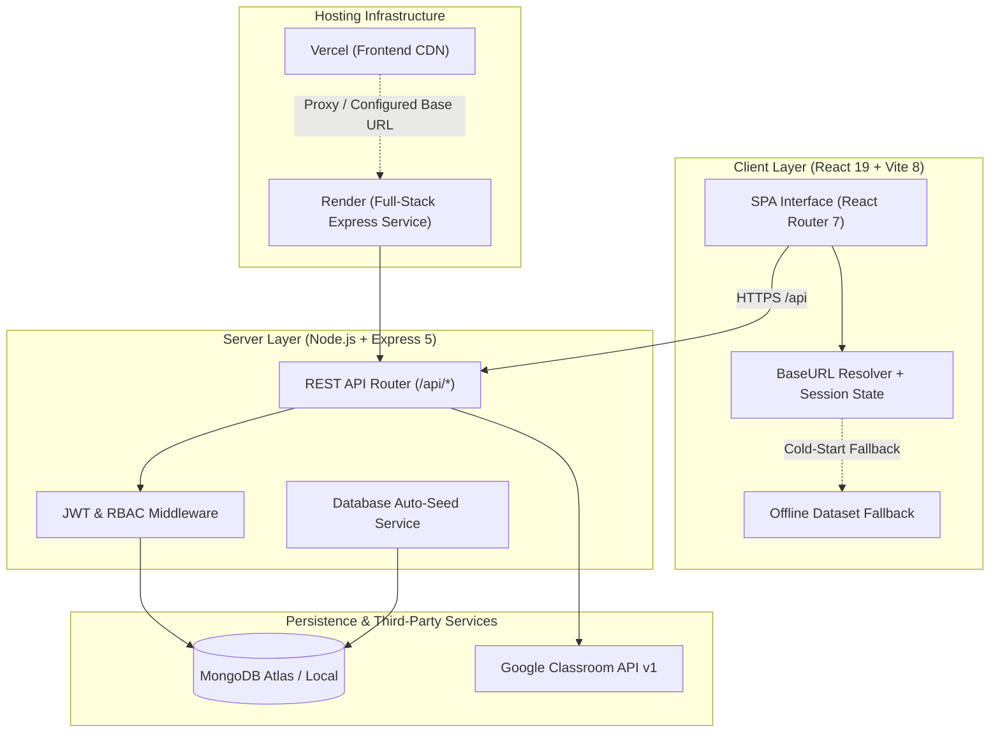

# RV University — Campus Connect Portal

[](https://nodejs.org/)
[](https://expressjs.com/)
[](https://react.dev/)
[](https://vitejs.dev/)
[](https://www.mongodb.com/)
[](https://render.com/)
[](https://vercel.com/)
[](https://opensource.org/licenses/ISC)

Campus Connect Portal is a full-stack academic management and learning portal developed for RV University, Bengaluru. It integrates course management, digital assignment submissions, evaluation workflows, attendance monitoring with institutional threshold validation, administrative governance, and Google Classroom synchronization.

---

## Architecture Overview



---

## Role-Based Access Control (RBAC)

The system enforces role-based access across three distinct user roles:

### 1. Student Portal
- **Dashboard**: Enrolled courses and credits across schools (SoCSE, SoB, SoDI, SoE, SoLAS).
- **Assignments**: Coursework briefs, submission deadlines, submission uploads (links and commentary), and faculty grading feedback.
- **Attendance**: Aggregate and course-level attendance tracking against the university's 75% minimum eligibility requirement.
- **Announcements**: Official campus notices and circulars categorized by priority.
- **Profile**: Student credentials, USN, academic branch, and persistent profile photo upload.
- **Classroom Synchronization**: One-click Google Classroom account connection and sync.

### 2. Faculty Portal
- **Course Administration**: Listing of active courses and enrolled cohorts.
- **Assignment Authoring**: Creation and management of coursework with scoring criteria and deadlines.
- **Grading Workflow**: Review of student submissions, grade assignment, and textual feedback.
- **Attendance Registry**: Digital roll-call marking and session history persistence.
- **Cohort Announcements**: Publishing announcements directly to enrolled students.

### 3. Institutional Administration
- **Executive Metrics**: Aggregate counts for enrolled students, faculty, active coursework, and submissions.
- **User Directory**: Search and filter accounts by name, USN, employee ID, role, and department, with account status controls.
- **Campus Broadcast**: System-wide publication of official administrative circulars.
- **System Audit**: Server status, database connection monitoring, active sessions, and audit logging.

---

## Technology Stack

### Frontend (`client--/`)
- React 19
- Vite 8
- React Router 7
- Axios (configured with 60-second timeout, JWT request interceptors, and dynamic base URL detection)
- Inline SVG icons (`Icons.jsx`)

### Backend (`server/`)
- Node.js (v20+)
- Express 5
- MongoDB / Mongoose 9
- JSON Web Token (`jsonwebtoken`) and `bcryptjs`
- Google APIs Node.js Client (`googleapis`)
- CORS and JSON parsing middleware

---

## Directory Structure

```
campus-connect-portal/
├── client--/                      # React frontend
│   ├── public/                    # Static assets
│   ├── src/
│   │   ├── components/            # UI components
│   │   │   ├── AdminPortal.jsx    # Administration console
│   │   │   ├── AuthModule.jsx     # Authentication and backend connection modal
│   │   │   ├── FacultyPortal.jsx  # Faculty course and grading management
│   │   │   └── Icons.jsx          # SVG icon definitions
│   │   ├── pages/
│   │   │   ├── Dashboard.jsx      # Student portal and role router
│   │   │   └── LandingPage.jsx    # Public landing page
│   │   ├── api.js                 # API client configuration and fallbacks
│   │   ├── mockData.js            # Offline dataset
│   │   ├── style.css              # Stylesheet
│   │   ├── App.jsx                # Application routes
│   │   └── main.jsx               # Application entry point
│   ├── package.json
│   ├── vercel.json                # Vercel configuration
│   └── vite.config.js
│
├── server/                        # Express backend
│   ├── src/
│   │   ├── config/
│   │   │   ├── db.js              # Database connection
│   │   │   └── seed.js            # Initial dataset seed
│   │   ├── controllers/
│   │   │   ├── adminController.js
│   │   │   ├── authController.js
│   │   │   ├── classroomController.js
│   │   │   └── facultyController.js
│   │   ├── middleware/
│   │   │   └── auth.js            # JWT validation and RBAC guards
│   │   ├── models/                # Data models
│   │   │   ├── Assignment.js
│   │   │   ├── Attendance.js
│   │   │   ├── Course.js
│   │   │   ├── Notice.js
│   │   │   ├── Submission.js
│   │   │   └── User.js
│   │   ├── routes/                # Express routes
│   │   └── app.js                 # Server entry point
│   ├── test/
│   │   └── smoke.test.js          # Smoke test suite
│   ├── .env.example
│   └── package.json
│
├── package.json                   # Root package configuration
├── render.yaml                    # Render blueprint
├── vercel.json                    # Root Vercel routing
└── README.md
```

---

## Local Installation and Setup

### Prerequisites
- Node.js 18.x or higher
- MongoDB instance (local service or MongoDB Atlas)

### Installation
```bash
git clone https://github.com/nish-debug15/campus-connect-portal.git
cd campus-connect-portal
npm run install:all
```

### Running Development Servers
```bash
npm run dev
```

- Client: `http://localhost:5173`
- Server: `http://localhost:5000`
- Health check: `http://localhost:5000/api/health`

Individual services can be started independently:
```bash
# Backend only
npm run server

# Frontend only
npm run client
```

---

## Automated Test Suite

Run the integration smoke test suite:

```bash
npm test
```

The test script executes 16 checks verifying core API functions:

1. Health probe validation (`/api/health`)
2. Student authentication and token generation
3. Faculty authentication and token generation
4. Administrator authentication and token generation
5. RBAC enforcement (verifying 403 responses for unauthorized roles)
6. Faculty assignment creation
7. Student coursework synchronization
8. Student coursework submission
9. Faculty submission retrieval
10. Faculty grading and feedback persistence
11. Student grade retrieval
12. Faculty attendance register recording
13. Student attendance calculations
14. Administrative circular broadcast
15. Student circular feed retrieval
16. Production static client asset serving

---

## API Reference

### Health
| Method | Endpoint | Authorization | Description |
| :--- | :--- | :---: | :--- |
| `GET` | `/api/health` | None | Returns server health status and timestamp |

### Authentication
| Method | Endpoint | Authorization | Description |
| :--- | :--- | :---: | :--- |
| `POST` | `/api/auth/register` | None | Register a new user account |
| `POST` | `/api/auth/login` | None | Authenticate credentials and issue JWT token |

### Student and Google Classroom
| Method | Endpoint | Authorization | Description |
| :--- | :--- | :---: | :--- |
| `GET` | `/api/classroom/connect-url` | Student | Generates Google OAuth 2.0 authorization URL |
| `GET` | `/api/classroom/status` | Student | Returns current classroom connection status |
| `POST` | `/api/classroom/sync` | Student | Synchronizes courses, coursework, and notices |
| `POST` | `/api/classroom/assignments/:id/submit` | Student | Submits coursework with repository URL and text |
| `GET` | `/api/classroom/assignments/:id/submission` | Student | Retrieves student submission status and score |
| `GET` | `/api/classroom/attendance` | Student | Returns attendance breakdown and percentage |

### Faculty
| Method | Endpoint | Authorization | Description |
| :--- | :--- | :---: | :--- |
| `GET` | `/api/faculty/courses` | Faculty | Returns assigned courses |
| `GET` | `/api/faculty/assignments` | Faculty | Returns created coursework assignments |
| `POST` | `/api/faculty/assignments` | Faculty | Creates a new coursework assignment |
| `DELETE` | `/api/faculty/assignments/:id` | Faculty | Deletes an assignment |
| `GET` | `/api/faculty/assignments/:id/submissions` | Faculty | Retrieves student submissions for an assignment |
| `POST` | `/api/faculty/submissions/:id/grade` | Faculty | Submits numerical grade and feedback |
| `POST` | `/api/faculty/announcements` | Faculty | Posts announcement to student cohort |
| `GET` | `/api/faculty/students` | Faculty | Returns enrolled student roster |
| `POST` | `/api/faculty/attendance` | Faculty | Records attendance session register |

### Administration
| Method | Endpoint | Authorization | Description |
| :--- | :--- | :---: | :--- |
| `GET` | `/api/admin/metrics` | Admin | Returns aggregate institutional metrics |
| `GET` | `/api/admin/users` | Admin | Returns user accounts list |
| `DELETE` | `/api/admin/users/:id` | Admin | Deactivates a user account |
| `POST` | `/api/admin/broadcast` | Admin | Publishes a campus-wide circular |
| `GET` | `/api/admin/system` | Admin | Returns system audit logs and health data |

---

## Production Deployment

### Option A: Render (Full-Stack Deployment)
Render serves both the Express API and compiled React SPA from a single web service.

1. Create a new Web Service on Render linked to this repository.
2. Configure service settings:
   - Environment: `Node`
   - Build Command: `npm run build`
   - Start Command: `npm start`
3. Configure environment variables:
   - `NODE_ENV`: `production`
   - `PORT`: `5000`
   - `JWT_SECRET`: Secure string
   - `DEMO_MODE`: `true`
   - `MONGO_URI`: MongoDB connection string
4. Deploy the service.

The included `render.yaml` blueprint can also be used for automated configuration.

### Option B: Vercel (Frontend) and Render (Backend)
When deploying the frontend independently on Vercel:

1. Deploy the backend service to Render as detailed in Option A.
2. On Vercel, import the repository with default settings (`Vite` framework preset).
3. Set the `VITE_API_URL` environment variable to your Render service API URL (e.g., `https://your-service.onrender.com/api`).
4. If `VITE_API_URL` is omitted, the in-app connection configuration panel on the login screen allows setting the backend URL dynamically at runtime.

---

## Resilience and Fail-Safe Architecture

1. **Immediate Port Binding**: The HTTP listener initiates immediately on process launch so cloud health checks pass without delay. Database connections and seed verification run asynchronously in the background.
2. **Extended Client Timeouts**: Axios client timeout is set to 60 seconds to accommodate cloud free-tier instance cold starts.
3. **HTML Response Detection**: Client interceptors detect HTML responses from proxies or misconfigured endpoints and display diagnostic messages rather than uncaught JSON parse errors.
4. **Offline Demo Fallback**: When backend connectivity is unavailable, the application provides an offline demo mode powered by a preloaded institutional dataset to allow functionality testing.

---

## License

This project is licensed under the ISC License.
